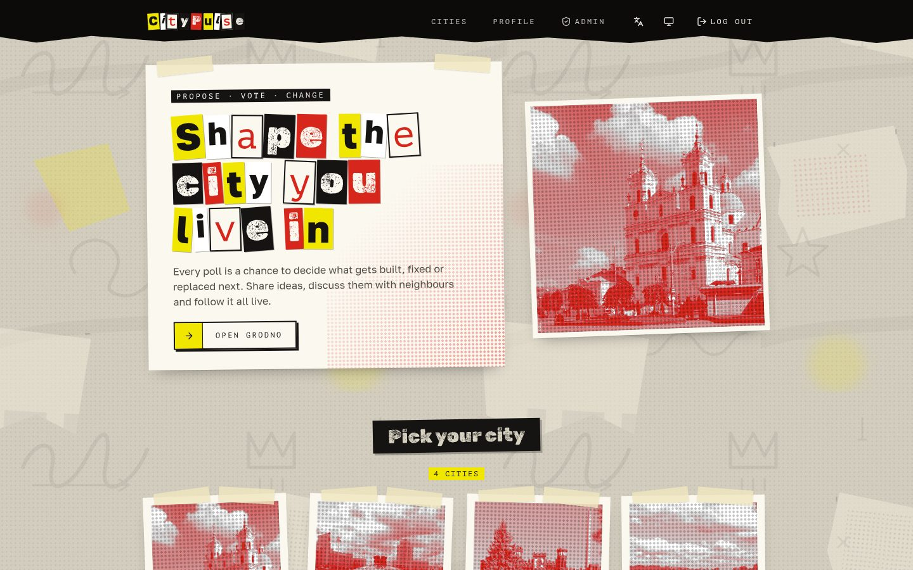
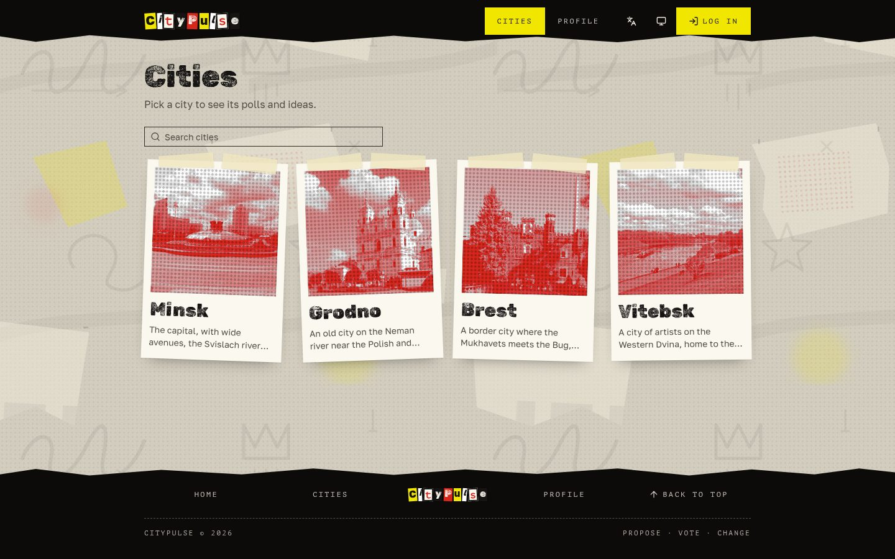
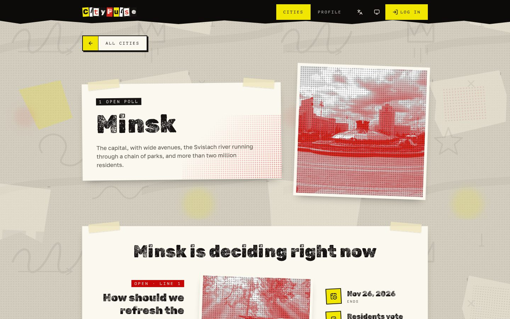
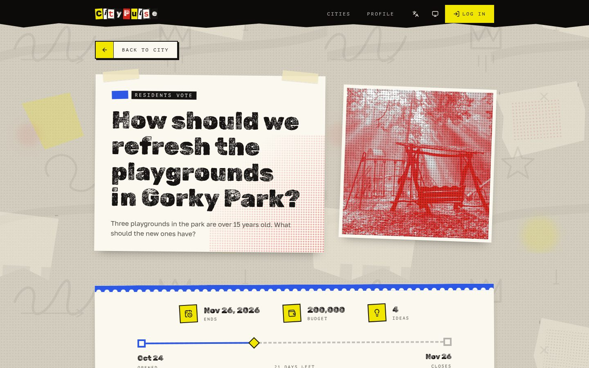
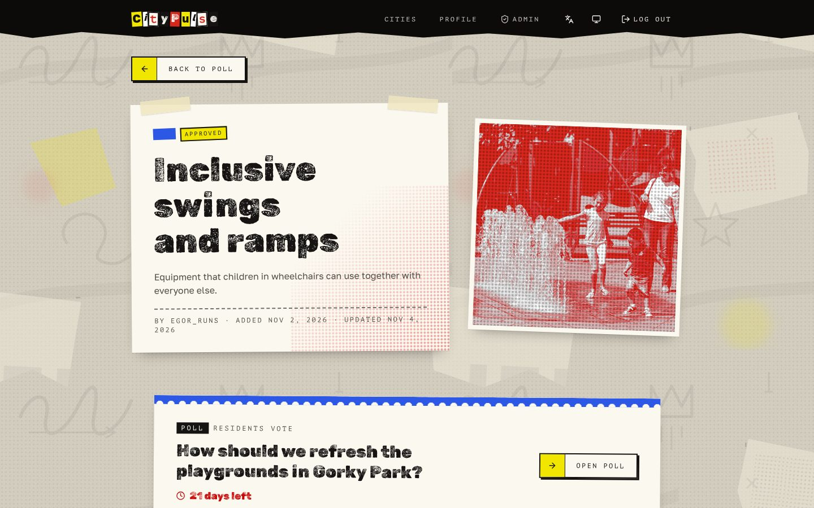
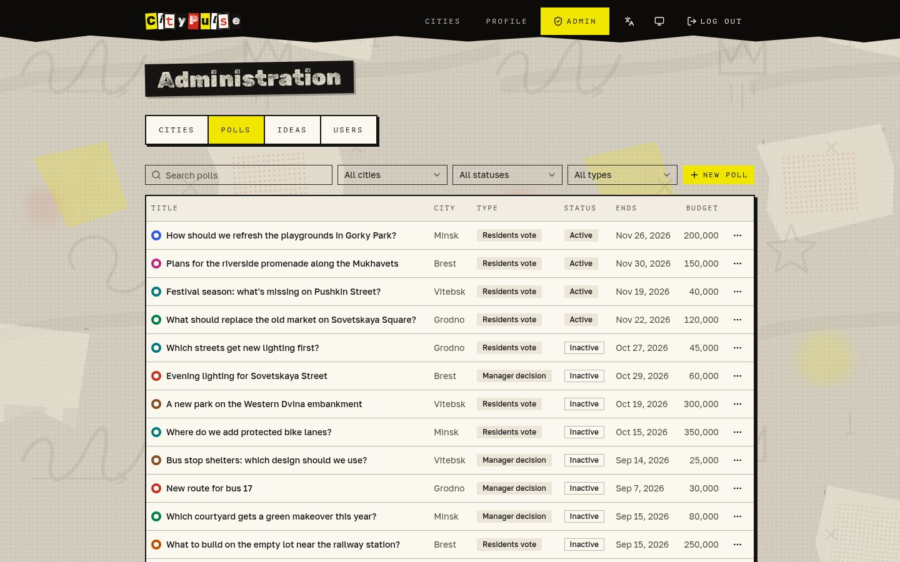
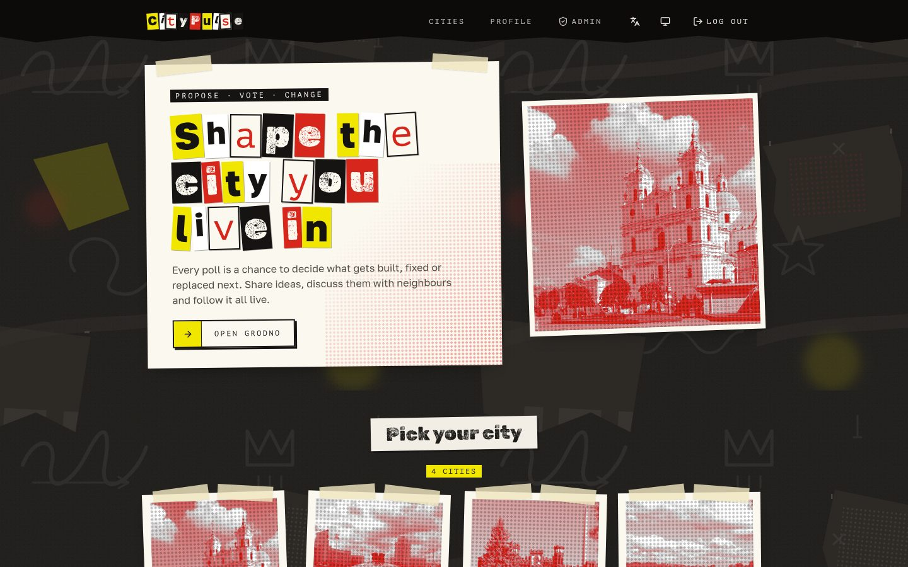
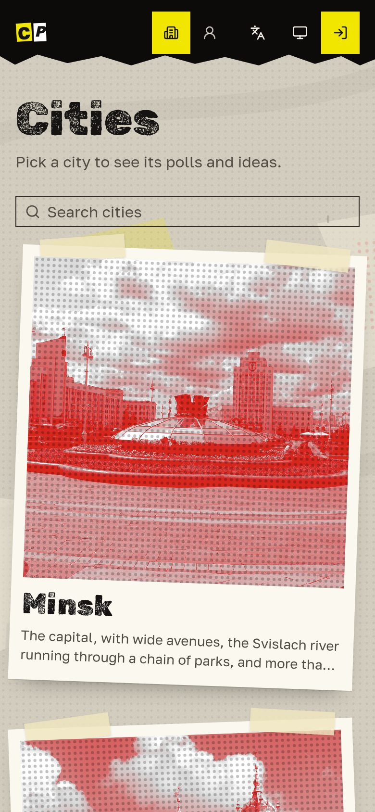
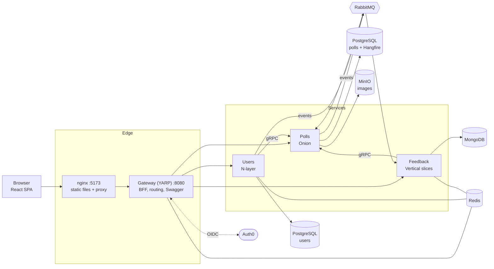

<p align="center">
  
</p>

<h1 align="center">CityPulse</h1>

<p align="center">
  A civic participation platform: residents propose ideas, discuss them and vote on how their city changes.
</p>

<p align="center">
  <b>English</b> · <a href="README.ru.md">Русский</a>
</p>

<p align="center">
  <a href="https://github.com/SubochArtem/CityPulse/actions/workflows/sonar.yml"></a>
  <a href="https://github.com/SubochArtem/CityPulse/actions/workflows/frontend.yml"></a>
  <a href="https://sonarcloud.io/summary/new_code?id=SubochArtem_CityPulse"></a>
  <a href="LICENSE"></a>
</p>

---

## Contents

- [Features](#features)
- [Screenshots](#screenshots)
- [Architecture](#architecture)
- [Tech stack](#tech-stack)
- [Getting started](#getting-started)
- [Local development](#local-development)
- [Testing](#testing)
- [Project structure](#project-structure)
- [License](#license)

## Features

- **Cities and polls.** Each city runs polls about what to build, fix or replace. A poll is either a residents' vote or a manager's decision, has a budget and a deadline, and closes automatically.
- **Ideas.** Residents of a city submit ideas with photos to its active poll. Moderators approve or reject them and can hide them.
- **Discussion.** Likes and comments on every idea.
- **Live activity feed.** New polls, ideas and comments appear on the home page in real time over SignalR.
- **Administration.** Managing cities, polls, idea moderation and users, with access driven by permissions.
- **Secure sign-in.** Auth0 behind a Backend-for-Frontend: tokens never reach the browser, which holds only an httpOnly session cookie.
- **Two languages and themes.** English and Russian, light and dark ("night wall") modes, responsive layout.

## Screenshots

| Home (live feed) | Cities |
| --- | --- |
|  |  |
| **City** | **Poll** |
|  |  |
| **Idea** | **Administration** |
|  |  |
| **Dark theme** | **Mobile** |
|  |  |

## Architecture

CityPulse is a set of .NET microservices behind a YARP API gateway, with a React single-page app in front.



| Component | Responsibility | Architecture | Storage |
| --- | --- | --- | --- |
| **Gateway** | Single entry point: routing with YARP, Backend-for-Frontend (Auth0 OIDC login, server-side tokens, refresh, CSRF check), aggregated Swagger | — | Redis (sessions, Data Protection keys) |
| **Users** | Profiles, home city, roles and permissions, Auth0 webhook and Management API sync | Strict N-layer: Presentation → Business → DataAccess | PostgreSQL, Redis (cache) |
| **Polls** | Cities, polls, ideas, images, scheduled poll status changes, gRPC server for other services | Onion: Domain, Application, Infrastructure, API | PostgreSQL, Hangfire, MinIO |
| **Feedback** | Likes and comments, activity feed, SignalR hub `/hubs/activity` | Vertical slices under `Features/` | MongoDB, Redis (cache, SignalR backplane) |
| **Frontend** | SPA served by nginx, which proxies `/api`, `/bff` and `/hubs` to the gateway | Feature folders | — |

**Communication**

- **HTTP** — the browser talks only to the gateway, same-origin through nginx (or the Vite dev proxy).
- **gRPC** — Users and Feedback read cities and ideas from Polls (`:8081`, HTTP/2).
- **Events** — Polls publishes integration events (poll and idea created, status changed, deleted) through the MassTransit transactional outbox to RabbitMQ; Users publishes user status changes. Feedback consumes them to build the activity feed and pushes updates to clients over SignalR; Polls reacts to user status changes.
- **Shared contracts** — `src/Backend/Services/Shared` holds NuGet packages (common API setup, auth, events, gRPC, querying) published to GitHub Packages.

**Authentication flow**

1. The SPA sends the user to `/bff/login`; the gateway runs the OIDC code flow with Auth0 as a confidential client.
2. Tokens are stored server-side in Redis. The browser receives only an httpOnly `SameSite=Lax` `citypulse.session` cookie.
3. On every `/api` call the gateway attaches the access token, refreshes it when it is about to expire and requires an `X-CSRF: 1` header on unsafe methods.
4. Services validate the JWT and authorize by permissions issued by Auth0.

## Tech stack

**Backend**

- .NET 8, ASP.NET Core, YARP reverse proxy
- Entity Framework Core + PostgreSQL, MongoDB.Driver
- MassTransit + RabbitMQ (transactional outbox), gRPC, SignalR with Redis backplane
- Hangfire (scheduled jobs), MinIO (S3-compatible image storage)
- MediatR, FluentValidation, Mapster / AutoMapper, ErrorOr
- Auth0 (OIDC, JWT, Management API), Serilog, Swagger
- xUnit, Moq, Testcontainers, Respawn, Bogus

**Frontend**

- React 19, TypeScript, Vite
- Tailwind CSS 4, shadcn/ui (Radix)
- TanStack Query, React Router, openapi-fetch with types generated from Swagger
- i18next (English, Russian), `@microsoft/signalr`

**Infrastructure**

- Docker, Docker Compose, nginx
- GitHub Actions: build, tests, SonarCloud analysis, NuGet package publishing

## Getting started

### Prerequisites

- [Docker](https://docs.docker.com/get-docker/) with Docker Compose v2
- A GitHub personal access token with `read:packages` (the services restore shared NuGet packages from GitHub Packages)
- An [Auth0](https://auth0.com/) tenant with:
  - an API (its identifier is the audience) with RBAC and permissions in the access token enabled;
  - a **Regular Web Application** for the gateway BFF, with callback `http://localhost:5173/bff/callback`, logout URL `http://localhost:5173` and refresh token rotation;
  - a **Single Page Application** for Swagger UI;
  - a **Machine to Machine** application for the Management API (used by Users).

### 1. Configure the environment

```bash
git clone https://github.com/SubochArtem/CityPulse.git
cd CityPulse
cp .env.example .env
```

Fill in `.env`:

| Variable | Description |
| --- | --- |
| `MINIO_ROOT_USER`, `MINIO_ROOT_PASSWORD` | MinIO credentials |
| `MINIO_PUBLIC_URL` | Public base URL for images, default `http://localhost:9000` |
| `RABBITMQ_DEFAULT_USER`, `RABBITMQ_DEFAULT_PASS` | RabbitMQ credentials |
| `MONGO_INITDB_ROOT_USERNAME`, `MONGO_INITDB_ROOT_PASSWORD` | MongoDB credentials |
| `POSTGRES_USER`, `POSTGRES_PASSWORD` | PostgreSQL credentials (both databases) |
| `AUTH0_DOMAIN`, `AUTH0_AUDIENCE` | Auth0 tenant domain and API identifier |
| `AUTH0_CLIENT_ID`, `AUTH0_CLIENT_SECRET` | SPA application used by Swagger UI |
| `AUTH0_WEB_CLIENT_ID`, `AUTH0_WEB_CLIENT_SECRET` | Regular Web Application used by the gateway BFF |
| `AUTH0_MANAGEMENT_API_CLIENT_ID`, `AUTH0_MANAGEMENT_API_CLIENT_SECRET`, `AUTH0_MANAGEMENT_API_AUDIENCE` | Machine to Machine application for the Management API |
| `AUTH0_WEBHOOK_SECRET` | Shared secret for the Auth0 post-registration webhook |
| `GITHUB_TOKEN` | Token with `read:packages` for GitHub NuGet |

### 2. Run the whole stack

```bash
docker compose --profile app up -d --build
```

Database migrations are applied on startup. When every container is healthy:

| URL | What |
| --- | --- |
| http://localhost:5173 | Web app |
| http://localhost:8080/swagger | Swagger UI for all services |
| http://localhost:15672 | RabbitMQ management |
| http://localhost:9001 | MinIO console |

Stop everything with `docker compose --profile app down` (add `-v` to remove the data volumes).

## Local development

Start only the infrastructure (databases, RabbitMQ, Redis, MinIO):

```bash
docker compose up -d
```

Run a service from your IDE or the command line, for example:

```bash
dotnet run --project src/Backend/Services/Polls/Polls.API
```

Run the frontend with hot reload (the Vite dev server proxies `/api`, `/bff` and `/hubs` to the gateway on `:8080`; stop the `citypulse_frontend` container first, it uses the same port):

```bash
cd src/frontend
npm ci
npm run dev
```

Useful frontend scripts:

| Command | What |
| --- | --- |
| `npm run lint` | ESLint |
| `npm run typecheck` | TypeScript check |
| `npm run format:check` | Prettier check |
| `npm run build` | Production build |
| `npm run gen:api` | Regenerate API types from the gateway Swagger |

## Testing

Backend tests are xUnit; integration tests start real PostgreSQL, MongoDB and RabbitMQ with Testcontainers, so Docker must be running.

```bash
dotnet test                                          # everything
dotnet test src/Backend/Services/Polls/Polls.Tests   # one service
```

CI runs the backend build and tests with coverage on SonarCloud, and lint, format check and build for the frontend.

## Project structure

```text
CityPulse/
├── docker-compose.yml           # infrastructure + app profile
├── docker/                      # MinIO bucket policy
├── docs/screenshots/            # images for this README
└── src/
    ├── Backend/
    │   ├── Gateway/
    │   │   ├── Gateway.API      # YARP, BFF, Swagger aggregation
    │   │   └── Gateway.Tests
    │   └── Services/
    │       ├── Users/           # Presentation, Business, DataAccess, Tests
    │       ├── Polls/           # Domain, Application, Infrastructure, API, Tests
    │       ├── Feedback/        # Feedback.API (Features/*), Tests
    │       └── Shared/          # NuGet packages: Common.Api, Contracts.*
    └── frontend/                # React SPA, nginx config, Dockerfile
```

## License

Distributed under the [MIT License](LICENSE).
