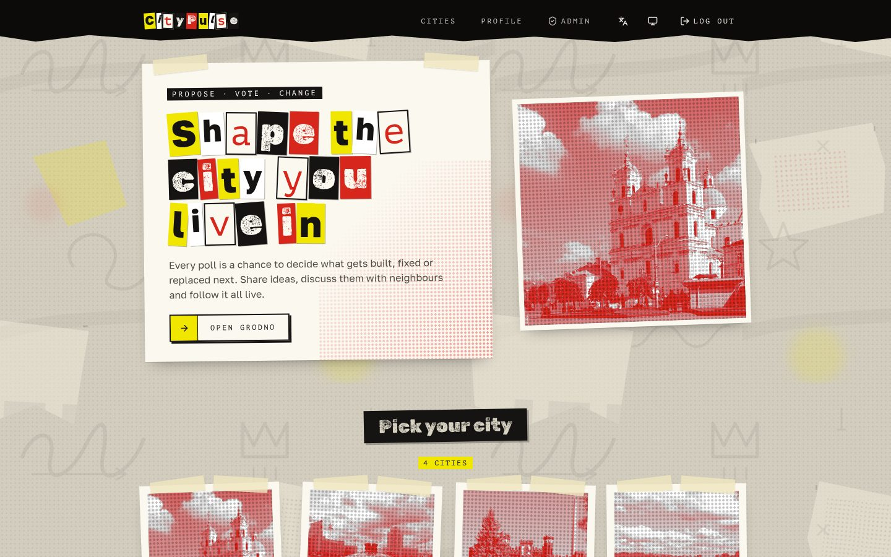
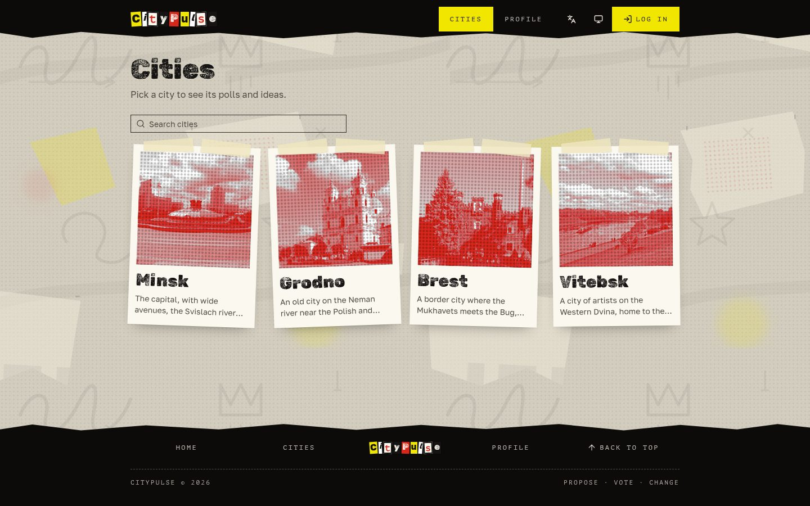
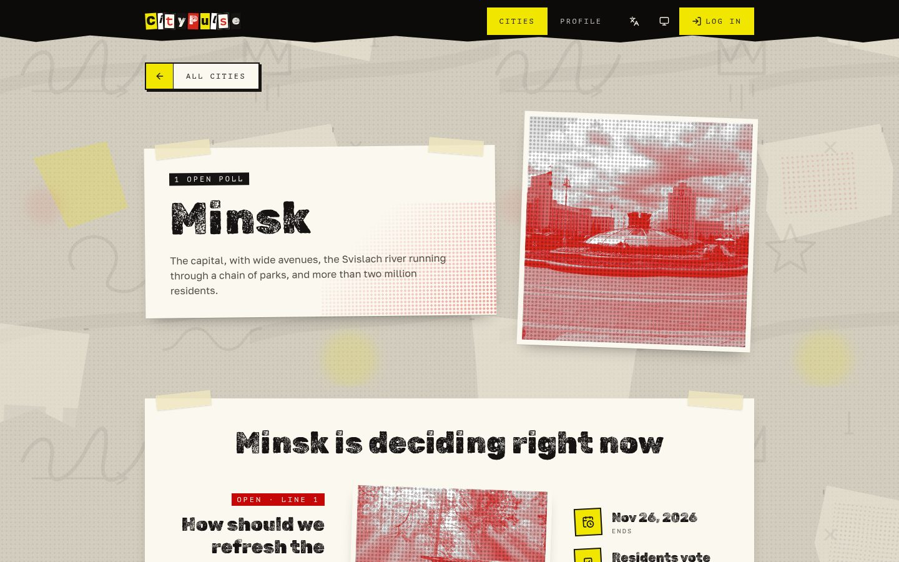
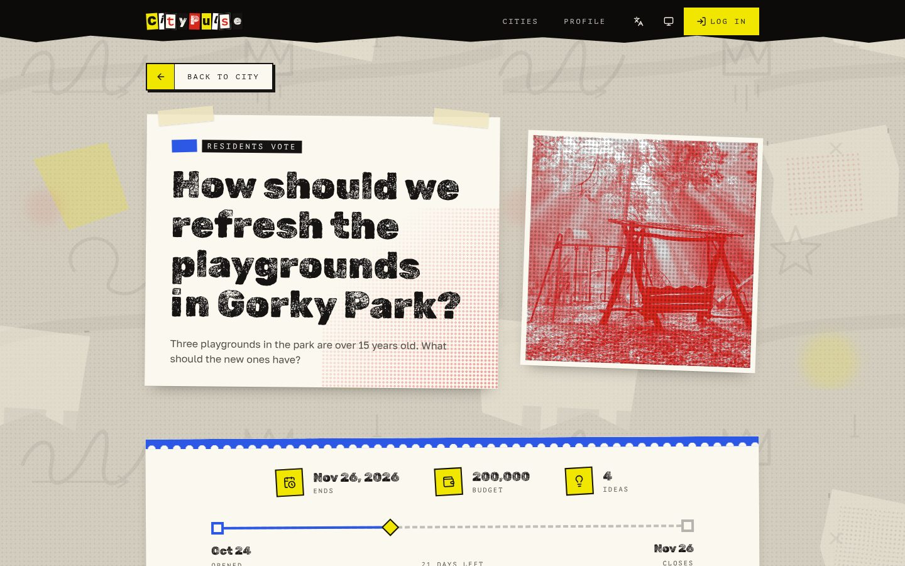
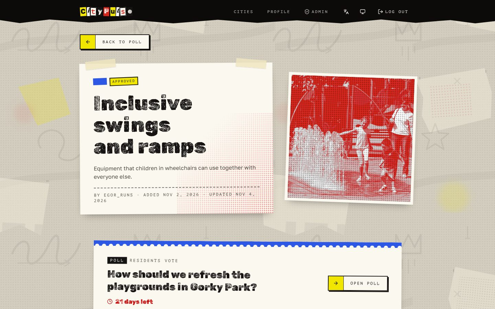
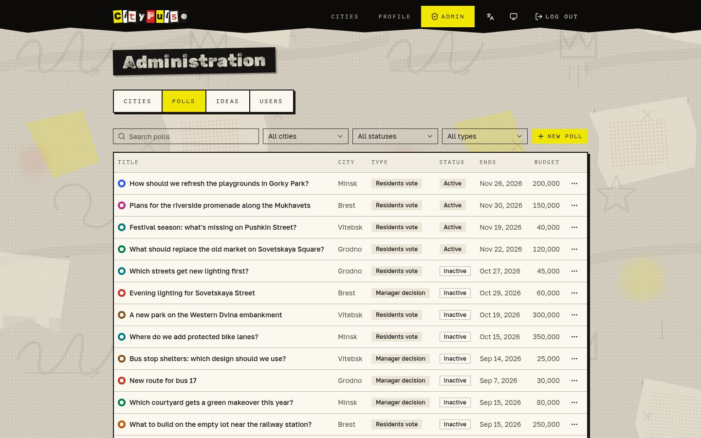
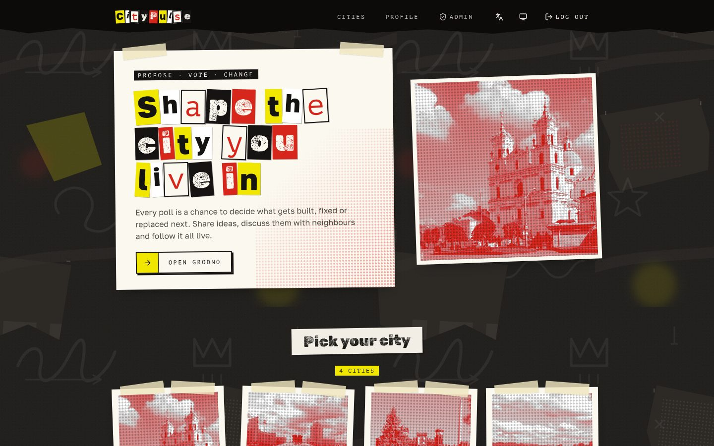
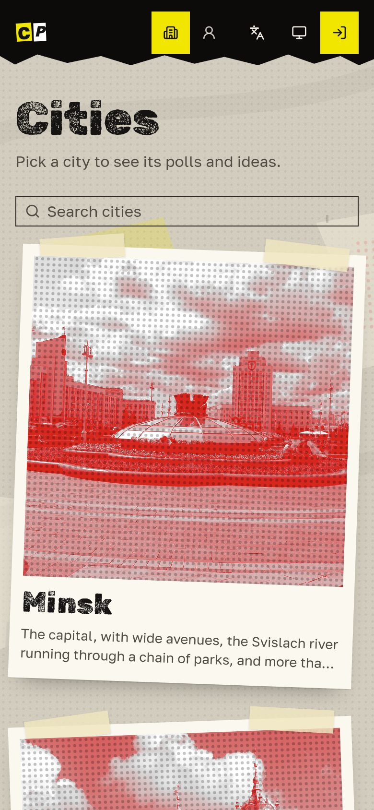
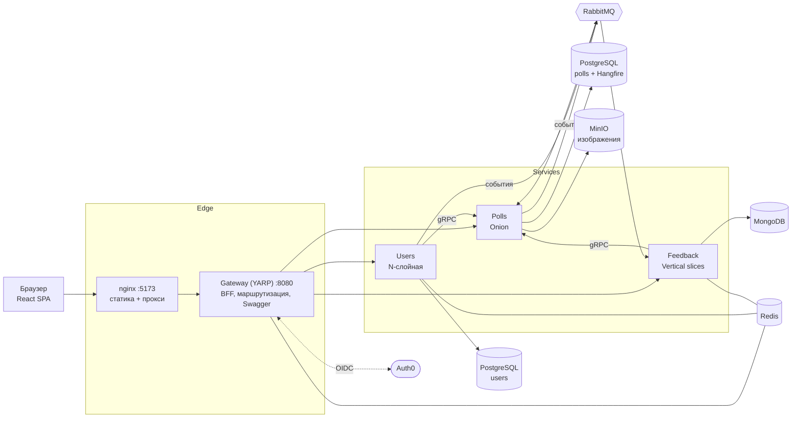

<p align="center">
  
</p>

<h1 align="center">CityPulse</h1>

<p align="center">
  Платформа городского участия: жители предлагают идеи, обсуждают их и голосуют за то, как меняется их город.
</p>

<p align="center">
  <a href="README.md">English</a> · <b>Русский</b>
</p>

<p align="center">
  <a href="https://github.com/SubochArtem/CityPulse/actions/workflows/sonar.yml"></a>
  <a href="https://github.com/SubochArtem/CityPulse/actions/workflows/frontend.yml"></a>
  <a href="https://sonarcloud.io/summary/new_code?id=SubochArtem_CityPulse"></a>
  <a href="LICENSE"></a>
</p>

---

## Содержание

- [Возможности](#возможности)
- [Скриншоты](#скриншоты)
- [Архитектура](#архитектура)
- [Технологии](#технологии)
- [Запуск](#запуск)
- [Локальная разработка](#локальная-разработка)
- [Тестирование](#тестирование)
- [Структура проекта](#структура-проекта)
- [Лицензия](#лицензия)

## Возможности

- **Города и опросы.** В каждом городе идут опросы о том, что построить, починить или заменить. Опрос — это либо голосование жителей, либо решение руководителя; у него есть бюджет и срок, а закрывается он автоматически.
- **Идеи.** Жители города предлагают идеи с фотографиями в активный опрос. Модераторы одобряют или отклоняют их и могут скрывать.
- **Обсуждение.** Лайки и комментарии к каждой идее.
- **Живая лента активности.** Новые опросы, идеи и комментарии появляются на главной странице в реальном времени через SignalR.
- **Администрирование.** Управление городами, опросами, модерация идей и пользователей; доступ определяется разрешениями.
- **Безопасный вход.** Auth0 за Backend-for-Frontend: токены не попадают в браузер, у него есть только httpOnly cookie сессии.
- **Два языка и темы.** Английский и русский, светлая и тёмная («ночная стена») темы, адаптивная вёрстка.

## Скриншоты

| Главная (живая лента) | Города |
| --- | --- |
|  |  |
| **Город** | **Опрос** |
|  |  |
| **Идея** | **Администрирование** |
|  |  |
| **Тёмная тема** | **Мобильная версия** |
|  |  |

## Архитектура

CityPulse — набор микросервисов на .NET за API-шлюзом YARP и одностраничное React-приложение перед ними.



| Компонент | Ответственность | Архитектура | Хранилище |
| --- | --- | --- | --- |
| **Gateway** | Единая точка входа: маршрутизация через YARP, Backend-for-Frontend (вход через Auth0 OIDC, токены на сервере, обновление, проверка CSRF), общий Swagger | — | Redis (сессии, ключи Data Protection) |
| **Users** | Профили, родной город, роли и разрешения, вебхук Auth0 и синхронизация через Management API | Строгая N-слойная: Presentation → Business → DataAccess | PostgreSQL, Redis (кэш) |
| **Polls** | Города, опросы, идеи, изображения, плановая смена статусов опросов, gRPC-сервер для других сервисов | Onion: Domain, Application, Infrastructure, API | PostgreSQL, Hangfire, MinIO |
| **Feedback** | Лайки и комментарии, лента активности, SignalR-хаб `/hubs/activity` | Вертикальные срезы в `Features/` | MongoDB, Redis (кэш, backplane SignalR) |
| **Frontend** | SPA, которое раздаёт nginx и проксирует `/api`, `/bff` и `/hubs` на шлюз | Папки по фичам | — |

**Взаимодействие**

- **HTTP** — браузер общается только со шлюзом, с того же origin через nginx (или dev-прокси Vite).
- **gRPC** — Users и Feedback читают города и идеи из Polls (`:8081`, HTTP/2).
- **События** — Polls публикует интеграционные события (создание, смена статуса и удаление опросов и идей) в RabbitMQ через транзакционный outbox MassTransit; Users публикует смену статуса пользователя. Feedback собирает из них ленту активности и рассылает обновления клиентам через SignalR; Polls реагирует на смену статуса пользователя.
- **Общие контракты** — в `src/Backend/Services/Shared` лежат NuGet-пакеты (общая настройка API, авторизация, события, gRPC, запросы), которые публикуются в GitHub Packages.

**Аутентификация**

1. SPA отправляет пользователя на `/bff/login`; шлюз выполняет OIDC code flow с Auth0 как конфиденциальный клиент.
2. Токены хранятся на сервере в Redis. Браузер получает только httpOnly cookie `citypulse.session` с `SameSite=Lax`.
3. При каждом запросе к `/api` шлюз подставляет access token, обновляет его перед истечением и требует заголовок `X-CSRF: 1` для изменяющих методов.
4. Сервисы проверяют JWT и авторизуют по разрешениям, которые выдаёт Auth0.

## Технологии

**Backend**

- .NET 8, ASP.NET Core, обратный прокси YARP
- Entity Framework Core + PostgreSQL, MongoDB.Driver
- MassTransit + RabbitMQ (транзакционный outbox), gRPC, SignalR с backplane на Redis
- Hangfire (плановые задачи), MinIO (S3-совместимое хранилище изображений)
- MediatR, FluentValidation, Mapster / AutoMapper, ErrorOr
- Auth0 (OIDC, JWT, Management API), Serilog, Swagger
- xUnit, Moq, Testcontainers, Respawn, Bogus

**Frontend**

- React 19, TypeScript, Vite
- Tailwind CSS 4, shadcn/ui (Radix)
- TanStack Query, React Router, openapi-fetch с типами, сгенерированными из Swagger
- i18next (английский, русский), `@microsoft/signalr`

**Инфраструктура**

- Docker, Docker Compose, nginx
- GitHub Actions: сборка, тесты, анализ SonarCloud, публикация NuGet-пакетов

## Запуск

### Что понадобится

- [Docker](https://docs.docker.com/get-docker/) с Docker Compose v2
- Персональный токен GitHub с правом `read:packages` (сервисы скачивают общие NuGet-пакеты из GitHub Packages)
- Тенант [Auth0](https://auth0.com/), в котором есть:
  - API (его идентификатор — audience) с включёнными RBAC и разрешениями в access token;
  - **Regular Web Application** для BFF шлюза с callback `http://localhost:5173/bff/callback`, logout URL `http://localhost:5173` и ротацией refresh-токенов;
  - **Single Page Application** для Swagger UI;
  - **Machine to Machine** приложение для Management API (его использует Users).

### 1. Настройте окружение

```bash
git clone https://github.com/SubochArtem/CityPulse.git
cd CityPulse
cp .env.example .env
```

Заполните `.env`:

| Переменная | Описание |
| --- | --- |
| `MINIO_ROOT_USER`, `MINIO_ROOT_PASSWORD` | Учётные данные MinIO |
| `MINIO_PUBLIC_URL` | Публичный адрес изображений, по умолчанию `http://localhost:9000` |
| `RABBITMQ_DEFAULT_USER`, `RABBITMQ_DEFAULT_PASS` | Учётные данные RabbitMQ |
| `MONGO_INITDB_ROOT_USERNAME`, `MONGO_INITDB_ROOT_PASSWORD` | Учётные данные MongoDB |
| `POSTGRES_USER`, `POSTGRES_PASSWORD` | Учётные данные PostgreSQL (для обеих баз) |
| `AUTH0_DOMAIN`, `AUTH0_AUDIENCE` | Домен тенанта Auth0 и идентификатор API |
| `AUTH0_CLIENT_ID`, `AUTH0_CLIENT_SECRET` | SPA-приложение для Swagger UI |
| `AUTH0_WEB_CLIENT_ID`, `AUTH0_WEB_CLIENT_SECRET` | Regular Web Application для BFF шлюза |
| `AUTH0_MANAGEMENT_API_CLIENT_ID`, `AUTH0_MANAGEMENT_API_CLIENT_SECRET`, `AUTH0_MANAGEMENT_API_AUDIENCE` | Machine to Machine приложение для Management API |
| `AUTH0_WEBHOOK_SECRET` | Общий секрет для вебхука Auth0 после регистрации |
| `GITHUB_TOKEN` | Токен с `read:packages` для GitHub NuGet |

### 2. Запустите весь стек

```bash
docker compose --profile app up -d --build
```

Миграции баз данных применяются при старте. Когда все контейнеры станут healthy:

| Адрес | Что там |
| --- | --- |
| http://localhost:5173 | Веб-приложение |
| http://localhost:8080/swagger | Swagger UI всех сервисов |
| http://localhost:15672 | Панель RabbitMQ |
| http://localhost:9001 | Консоль MinIO |

Остановить всё: `docker compose --profile app down` (с `-v` удалятся и тома с данными).

## Локальная разработка

Запустите только инфраструктуру (базы данных, RabbitMQ, Redis, MinIO):

```bash
docker compose up -d
```

Запустите сервис из IDE или командной строки, например:

```bash
dotnet run --project src/Backend/Services/Polls/Polls.API
```

Запустите фронтенд с горячей перезагрузкой (dev-сервер Vite проксирует `/api`, `/bff` и `/hubs` на шлюз `:8080`; сначала остановите контейнер `citypulse_frontend`, он занимает тот же порт):

```bash
cd src/frontend
npm ci
npm run dev
```

Полезные скрипты фронтенда:

| Команда | Что делает |
| --- | --- |
| `npm run lint` | ESLint |
| `npm run typecheck` | Проверка TypeScript |
| `npm run format:check` | Проверка Prettier |
| `npm run build` | Продакшен-сборка |
| `npm run gen:api` | Перегенерация типов API из Swagger шлюза |

## Тестирование

Тесты бэкенда написаны на xUnit; интеграционные тесты поднимают настоящие PostgreSQL, MongoDB и RabbitMQ через Testcontainers, поэтому Docker должен быть запущен.

```bash
dotnet test                                          # все тесты
dotnet test src/Backend/Services/Polls/Polls.Tests   # один сервис
```

CI собирает бэкенд и запускает тесты с покрытием в SonarCloud, а для фронтенда — линтер, проверку форматирования и сборку.

## Структура проекта

```text
CityPulse/
├── docker-compose.yml           # инфраструктура + профиль app
├── docker/                      # политика бакета MinIO
├── docs/screenshots/            # изображения для README
└── src/
    ├── Backend/
    │   ├── Gateway/
    │   │   ├── Gateway.API      # YARP, BFF, сводный Swagger
    │   │   └── Gateway.Tests
    │   └── Services/
    │       ├── Users/           # Presentation, Business, DataAccess, Tests
    │       ├── Polls/           # Domain, Application, Infrastructure, API, Tests
    │       ├── Feedback/        # Feedback.API (Features/*), Tests
    │       └── Shared/          # NuGet-пакеты: Common.Api, Contracts.*
    └── frontend/                # React SPA, конфиг nginx, Dockerfile
```

## Лицензия

Распространяется по [лицензии MIT](LICENSE).
